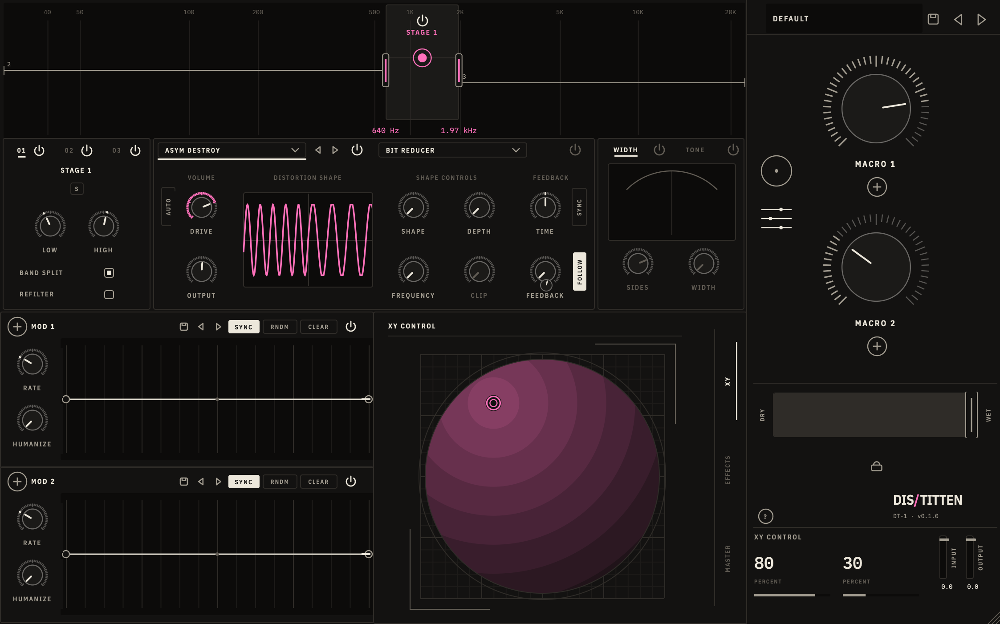

# DisTitten

A multistage distortion, rebuilt from Output Thermal by measuring
what Thermal does to sound. Three stages each heat one band of the signal
(distortion, then one of nine effects, width, gain and tone), two more effects
and a compressor follow, and two drawable envelopes and two macros move any of
it. Thermal's presets load as they are: pick one from the preset menu, turn the
macros or drag the XY pad, and draw your own movement on the edit page.



```
in ─ input ─┬─ stage 1 ─ stage 2 ─ stage 3 ─ FX 1 ─ FX 2 ─ master comp ─ HP/LP ─┬─ wet ─┐
            └─ dry (delayed to line up) ──────────────────────────────────────┴─ dry ─┴─ dry/wet ─ output ─ out

stage n:  band split ─┬─ lows ───────────────────────────────────────────────┬─ sum ─ tone
                      ├─ band ─ distortion ─ effect ─ width ─ gain ──────────┤
                      └─ highs ──────────────────────────────────────────────┘
```

VST3 and Audio Unit for macOS (universal), VST3 for Windows. JUCE 8.

## The controls

Every control has Thermal's range and taper (`src/core/model/Params.h`, one
row per parameter, 446 in all). The layout is Thermal's, control for control;
the look is ours.

**Both pages (right column)**

| Control | What it does |
|---------|--------------|
| **Preset bar** | Name, menu (your presets in `~/Music/DisTitten/Presets`, and Thermal's 355 factory presets, which DisTitten carries), save, previous / next |
| **MACRO 1 / MACRO 2** | 0–100 %. Each moves every parameter routed to it. Double-click the name to rename it. **+** assigns (see below) |
| **Page buttons** | The XY page and the edit page |
| **DRY / WET** | The whole plugin against its input, Thermal's v^(5/7) law each way. The lock keeps it when presets load |
| **?** | Help: hover any control and the readout says what it does |
| **XY CONTROL** | The two macro values |
| **INPUT / OUTPUT** | −60 to +6 dB, with level meters |

**XY page**: the pad. X is MACRO 2, Y is MACRO 1.

**Edit page**

| Section | Controls |
|---------|----------|
| **Band strip** | The selected stage's band: drag its edges, or the puck to move it. LOW and HIGH (30 Hz – 22 kHz) under it. The other stages are the thin tracks; click one to edit it |
| **Stage 01 / 02 / 03** | Power, **S** (solo the band), LOW, HIGH, BAND SPLIT (off: the whole signal goes through the stage), REFILTER |
| **Distortion** | 34 shapes, power, DRIVE and OUTPUT (±36 dB), AUTO (gain compensation), SHAPE, DEPTH, FREQUENCY, CLIP (what each does depends on the shape; unused ones dim), FEEDBACK with TIME (0.2–300 ms, or synced), its release and FOLLOW. The transfer curve shows the shape as set |
| **Stage effect** | One of nine (Bit Reducer, Chorus, Compressor, Delay, Filter, Flanger, Freq Shifter, Phaser, Reverb), power, input / output faders, the effect's own knobs and switches, dry/wet |
| **WIDTH / TONE** | SIDES (−36 to +12 dB) and WIDTH (a short left delay), or a 500 Hz low shelf and 5 kHz high shelf (±18 dB) |
| **MOD 1 / MOD 2** | Drawable envelopes: drag points, double-click to add or remove one, drag the dot in the middle of a segment to bend it. RATE (26 synced lengths from 8 bars to 1/64 triplet, or 0.005–30 Hz free), HUMANIZE, SYNC, RNDM, CLEAR, shape presets (Thermal's included), power, **+** to assign |
| **XY / EFFECTS / MASTER** | The pad again; FX 1 and FX 2 (the same nine effects); HP and LP cutoff, the master compressor (threshold −30–0 dB, ratio 2–20, attack, release, gain) with its gain-reduction gauge, input / output and dry/wet |

**Assigning modulation**: press a source's **+** (a macro's or an
envelope's), then drag any knob: the drag sets how far that source moves it
(Thermal's mod amount, −100 to +100 % of the knob's range). Press **+** again
to finish. A knob with modulation shows a dot where its modulated value is right
now.

Every knob: drag (Shift for fine), wheel, double-click to reset; double-click
its value while hovering to type one.

### What the colours mean

One accent, magenta, for the heat: the transfer curve, the rings of DRIVE and
the knobs that shape it, the band a stage is working on and the pad's glow.
Everything else is ink on the night sheet. Thermal's per-source colours (blue
MOD 1, green MOD 2, orange and yellow macros) are not used.

## How close it is to Thermal

Everything was measured from Thermal 1.2.1's output; the binary was not
decompiled. The method and every finding are in `docs/thermal-re/`.

- **Each mechanism alone** (gains, crossover, tone, width, the 34 distortion
  shapes, all nine effects, the compressor, filters, envelopes, macros,
  modulation routing): DisTitten's output minus Thermal's nulls to −92 dB or
  lower, most cases below −115 dB.
- **Whole factory presets**: of the 315 presets that render the same twice in
  Thermal, the median spectral distance is 0.02 dB, 89 % are within 1 dB, the
  worst is 4.9 dB. The rest of the 355 use HUMANIZE, which is random by design
  (in Thermal too).
- **Where it still differs**: presets with heavy feedback loops drift apart
  over time (Thermal computes in floats, DisTitten in doubles in places, and
  chaotic loops amplify the difference), and flanger and phaser LFOs can start
  at a different phase.

**On purpose different from Thermal**

- DisTitten reports its 93-sample delay to the host as latency. Thermal has
  the same delay but reports 0, so it plays late in a DAW.
- Switching a stage, WIDTH, TONE, the master compressor or an effect type
  crossfades over a few milliseconds instead of clicking.
- The delay line holds 16 seconds instead of Thermal's 48. It only matters
  for a synced delay of a bar below 15 bpm.

## Building

Requirements: macOS 11+, CMake 3.24+, Ninja, Xcode command line tools.

```sh
cmake -B build -G Ninja -DCMAKE_BUILD_TYPE=Release
cmake --build build
```

This installs the VST3 and AU into `~/Library/Audio/Plug-Ins`
(`-DDISTITTEN_COPY_PLUGIN=OFF` to skip that). JUCE 8 is downloaded
automatically; pass `-DFETCHCONTENT_SOURCE_DIR_JUCE=/path/to/JUCE` to use a
local checkout.

### Core only

The DSP doesn't depend on JUCE and builds in seconds:

```sh
cmake -B build-core -G Ninja -DCMAKE_BUILD_TYPE=Release -DDISTITTEN_BUILD_PLUGIN=OFF
cmake --build build-core
./build-core/distitten_tests
```

### UI snapshots

`build/distitten_snapshot_artefacts/Release/distitten_snapshot <dir>` renders
the editor to PNGs (`main`, `edit`, `busy`, `stagefx`, `comp`, `stage3`,
`assign`) with the built-in loop playing through it, no DAW needed.
`SNAP_PRESET="System Destruct"` loads a preset first, `SNAP_UI="page=1,stage=2"`
picks the page and tabs, `SNAP_KIT=2` plays the demo kit's second loop instead
of the built-in one. `... <dir> bench` times the paints instead.

### Rendering through the engine

`distitten_render <thermal-preset.xml|-> in.f32 out.f32 [sr=] [block=] [bpm=]`
runs raw stereo float audio through the engine with a Thermal preset, the way
the comparisons above were made.

### Trying it without a DAW

```sh
./start.sh               # the built-in kick + bass loop
./start.sh track.wav     # your file, looped
```

`start.sh` builds and opens the demo host: the plugin in a window with the
loop running through it and out of your speakers. **BYPASS** plays it
untouched for comparison; space plays and stops. The plugin gets a matching
looping transport, so synced envelopes and delays work as in a DAW.

Real samples come from a kit file: copy `demo-kit.example.txt` to
`demo-kit.txt` (ignored by git, sample packs aren't ours to share) and list a
kick, the bass shots (root first, up to three more notes of the same patch),
their tempo and the pattern; `start.sh` picks it up (or set `DT_DEMO_KIT`).
Lines like `loop = Vocal: dry phrase | ~/Samples/vocal.wav | 144` add more
material, each a source of its own in the host's menu: a distortion wants
drums, vocals, leads and guitars too. Without a kit the loop is synthesized
(`tools/PsyLoop.h`). For a configure
option on first run: `DT_CMAKE_ARGS=-D... ./start.sh`.

### Releases

Push a version tag and GitHub Actions builds, tests and validates the plugins
(pluginval at strictness 5, auval) and attaches the installers to a new
release:

```sh
git tag v1.2.0 && git push origin v1.2.0
```

You get a macOS `.pkg` (universal, VST3 + AU), a Windows setup `.exe` (VST3)
and a zip of the bare plug-ins for each. A suffix such as `v1.2.0-beta.1` makes
it a pre-release. The installer scripts are in `packaging/`.

The macOS build is signed with a Developer ID and notarized when these
repository secrets are set (Settings > Secrets and variables > Actions):

| Secret | Value |
|--------|-------|
| `MACOS_CERTIFICATES_P12` | base64 of a `.p12` holding both the *Developer ID Application* and the *Developer ID Installer* certificate with their keys |
| `MACOS_CERTIFICATES_PASSWORD` | the `.p12` password |
| `NOTARY_APPLE_ID` | Apple ID of the developer account |
| `NOTARY_PASSWORD` | an app-specific password for that Apple ID |

Without them the macOS build is unsigned and macOS blocks the `.pkg` the first
time (System Settings > Privacy & Security > Open Anyway). The Windows
installer is not signed, so SmartScreen asks once (More info > Run anyway).

## Project layout

```
src/core/fx        Thermal's nodes: distortion and its 34 shapes, the nine effects, compressor, routing (Structure.h)
src/core/mod       envelopes, macros, modulation routing
src/core/model     every parameter (Params.h, generated by tools/gen_params.py), names, the modulation state
src/core/engine    the whole chain (Engine.cpp) and an effect slot (EffectSlot.cpp)
src/plugin         JUCE processor, editor, Thermal preset import
src/ui             theme, controls, Thermal's layout (Layout.h) and the views
tests/             Catch2 tests for the engine
tools/             snapshot tool, demo host, distitten_render, the parameter generator
docs/thermal-re/   how Thermal was measured, and what was found
presets/thermal/   Thermal's factory presets and modulation shapes, built into the plugin
packaging/         macOS pkg and Windows installer scripts
```

## License

The plugin links JUCE 8 under the AGPLv3. IBM Plex fonts under the SIL Open
Font License (`resources/fonts/IBMPlex-OFL.txt`). Thermal, its presets
(`presets/thermal`) and Output are Output Inc.'s. This repository is private.
